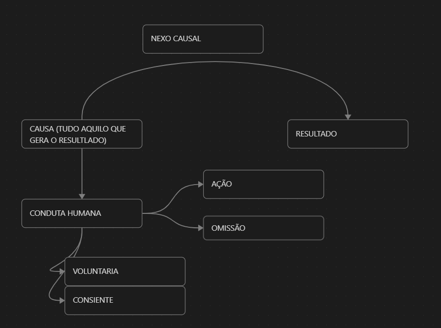
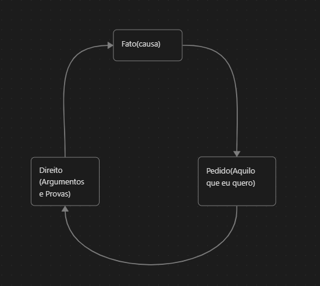
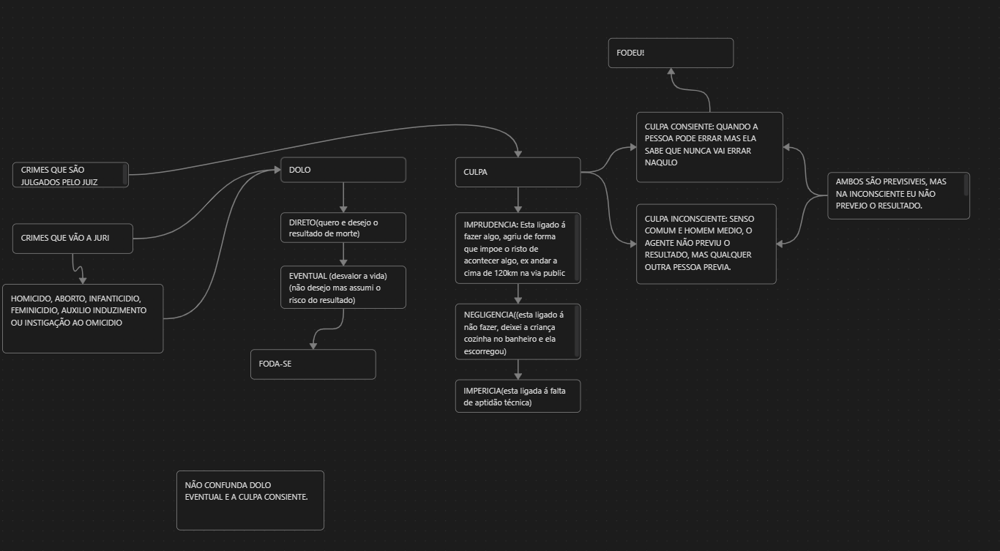
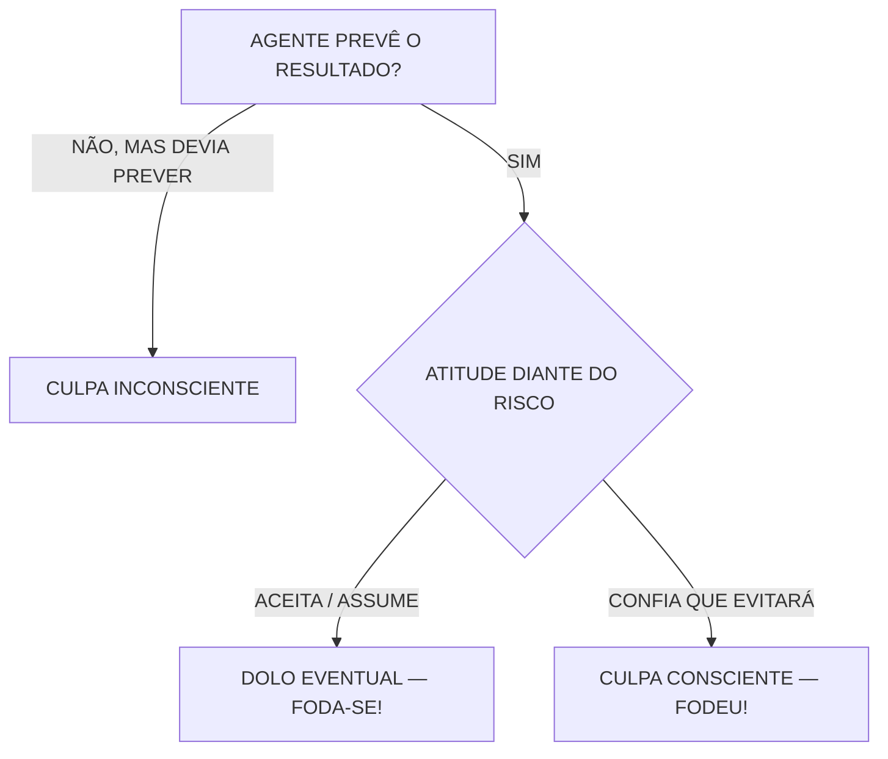

# DIREITO PENAL — M2 | GUIA DEFINITIVO DE ESTUDO — SLIDES E MAPAS

**UNIVALI · Parte Geral I · Prof. Sergio Virtuoso**  
**Base principal: PDF da aula, slides 66–99, NA ORDEM ORIGINAL.**  
**Apoio:** anotações e três mapas feitos em sala.  

> **Como estudar:** leia primeiro só o que estiver em **negrito**. Depois leia **um exemplo** de cada tema. Por último, tente responder às perguntas de revisão sem olhar.  
> **Estrutura:** definição em negrito, exemplo, macete e observação quando necessária.

---

# PARTE 1 — LEI PENAL NO ESPAÇO E REGRAS GERAIS (SLIDES 66–74)

## 1. Territorialidade e território — slide 66

**TERRITORIALIDADE:** **regra geral: aplica-se a lei penal brasileira ao crime cometido em território brasileiro**, respeitados tratados e regras internacionais (**art. 5º, CP**).

- **Território material:** **solo/subsolo, águas interiores, mar territorial e espaço aéreo correspondente**. O slide também menciona **plataforma continental**; sua disciplina é específica e não significa aplicação penal irrestrita a toda a plataforma.
- **Território por extensão:** **navios e aeronaves brasileiros** nas hipóteses do **art. 5º, § 1º, CP**. **Públicos ou a serviço do governo**, onde estiverem; **privados/mercantes**, nas situações legalmente previstas.

**Exemplo:** um crime cometido em Florianópolis, em regra, segue a **lei brasileira**.  
 **TERRITORIALIDADE = DENTRO DO BRASIL → LEI DO BRASIL.**

## 2. Extraterritorialidade incondicionada — slide 67

**EXTRATERRITORIALIDADE:** hipótese em que a **lei brasileira alcança crime praticado fora do Brasil**.

**INCONDICIONADA** (**art. 7º, I, CP**) → **não depende do conjunto de requisitos do § 2º**. Casos principais:

- **Vida ou liberdade do Presidente da República**.
- **Patrimônio ou fé pública de entes e entidades públicas** indicados na lei.
- **Administração pública**, por quem está a seu serviço.
- **Genocídio**, se o agente for **brasileiro ou domiciliado no Brasil**.

**Mesmo que tenha havido absolvição ou condenação no exterior**, a lei brasileira pode ser aplicada (**art. 7º, § 1º**), observadas outras normas aplicáveis.

 **INcondicionada = INdepende das condições do § 2º.**

## 3. Extraterritorialidade condicionada — slides 68–70

**CONDICIONADA** (**art. 7º, II, CP**): precisa cumprir **TODAS as condições do art. 7º, § 2º**.

**Hipóteses do inciso II:**

- **Tratado ou convenção:** crimes que o Brasil se obrigou a reprimir.
- **Nacionalidade ativa:** crime **praticado por brasileiro no exterior**.
- **Representação:** crime em **navio ou aeronave brasileira privada/mercante no estrangeiro**, quando lá **não julgado**, conforme a lei.

**As cinco condições cumulativas do § 2º:**

1. O agente **entrar no Brasil**.
2. O fato **também ser crime onde ocorreu**.
3. Ser crime **pelo qual a lei brasileira autoriza extradição**.
4. **Não ter sido absolvido no exterior nem cumprido lá a pena**.
5. **Não ter sido perdoado, nem estar extinta a punibilidade**, considerada a lei mais favorável.

 **ENTRA – DUPLO CRIME – EXTRADIÇÃO – SEM ABSOLVIÇÃO/PENA CUMPRIDA – SEM PERDÃO.**

**Estrangeiro contra brasileiro no exterior (§ 3º):** além das condições acima, exige **extradição não pedida ou negada** **E** **requisição do Ministro da Justiça**.

 **Não confunda:** **nacionalidade ativa = brasileiro AUTOR**; **nacionalidade passiva = brasileiro VÍTIMA**. A mera nacionalidade não dispensa os requisitos da lei.

## 4. Pena cumprida no estrangeiro — slide 71

**Art. 8º, CP:** para evitar punição duplicada sem abatimento:

- **Penas idênticas:** a pena já cumprida no exterior é **computada/descontada** na pena brasileira.
- **Penas diversas:** a pena cumprida fora **atenua** a pena brasileira.

 **IGUAL = DESCONTA | DIFERENTE = ATENUA.**

## 5. Eficácia da sentença estrangeira — slides 72–73

**Art. 9º, CP:** a sentença estrangeira **pode ser homologada no Brasil** para:

1. **Reparação do dano, restituições e outros efeitos civis** → exige **pedido da parte interessada**.
2. **Medida de segurança** → conforme o slide e art. 9º, parágrafo único, demanda **tratado de extradição ou requisição do Ministro da Justiça**.

 **EFEITO CIVIL = PARTE PEDE.**  
 **Atualização jurídica complementar:** o instituto da homologação e a competência para apreciar sentença estrangeira também devem ser estudados à luz da **Constituição e das regras processuais atuais**; para a prova, compare a redação do art. 9º com a explicação do professor.

## 6. Contagem de prazo — slide 74

- **Art. 10, CP:** **inclui o dia do começo** no prazo penal material; dias, meses e anos pelo **calendário comum**.
- **Art. 11, CP:** **desprezam-se frações de dia** nas penas privativas de liberdade e restritivas de direitos; o dispositivo ainda menciona a fração monetária na multa em redação histórica.

 **PRAZO PENAL MATERIAL = CONTA O PRIMEIRO DIA.**  
 **Prazos processuais** possuem regras distintas. Não aplique automaticamente o art. 10 do CP a todo prazo do processo.

---

# PARTE 2 — O QUE É CRIME? (SLIDES 75–78)

## 7. Três conceitos de crime — slides 75–78

| Conceito | Pergunta que ele responde | Definição de prova |
|---|---|---|
| **Formal** (76) | Está previsto na lei? | Crime é aquilo que a lei penal define como infração criminosa. |
| **Material** (77) | Por que merece punição? | Conduta que **lesa ou expõe a perigo** bem jurídico relevante. |
| **Analítico** (78) | Quais elementos estruturam o crime? | **Fato típico + antijuridicidade + culpabilidade**, na teoria tripartida apresentada no slide. |

**Conceito analítico (teoria tripartida apresentada no slide 78):**

**CRIME = FATO TÍPICO + ILICITUDE (ANTIJURIDICIDADE) + CULPABILIDADE.**

 **F–M–A = Fala da lei – Mede a lesão – Analisa os elementos.**  
 **T.I.C. = Típico, Ilícito, Culpável.**

**Exemplo:** matar alguém é descrito no **art. 121** (**formal**); ofende a **vida** (**material**); e é examinado conforme **tipicidade, ilicitude e culpabilidade** (**analítico**).

---

# PARTE 3 — FATO TÍPICO, NA SEQUÊNCIA DO PROFESSOR (SLIDES 79–90)

## 8. Quatro elementos do fato típico — slide 79

**FATO TÍPICO:** **conduta humana que se encaixa em uma descrição penal**.

**1. CONDUTA → 2. RESULTADO → 3. NEXO CAUSAL → 4. TIPICIDADE.**

 **Co–Re–Ne–Ti = COnduta, REsultado, NExo, Tipicidade.**  
 **Atenção:** o esquema de quatro elementos é especialmente útil para **crimes materiais consumados**. Há **crimes sem resultado naturalístico exigido**, e a **tentativa** pode ocorrer sem consumação do resultado.

## 9. Conduta humana — slide 80

**CONDUTA:** **ação ou omissão humana, exteriorizada e voluntária**.

- **AÇÃO:** **fazer algo**.
- **OMISSÃO:** **deixar de agir** quando o Direito impõe uma conduta.
- **Pensar ou planejar, sem exteriorizar comportamento, não basta**.
- **Voluntariedade:** o movimento ou a abstenção é **controlado pela vontade**. **Consciência** envolve percepção/compreensão da situação; não confunda com intenção de produzir o resultado.

**Anotação de aula:** **dolo = quero o resultado ou assumo seu risco**; **culpa = resultado não querido, relacionado à violação de um dever de cuidado**.  Isso é um resumo; os critérios completos estão na revisão complementar.

**Coação física irresistível:** pode **afastar a conduta voluntária**. **Coação moral irresistível:** não elimina necessariamente o movimento voluntário; pode **excluir a culpabilidade** (**art. 22, CP**).

 **CONDUTA = ATO EXTERNO + VONTADE (não é pensamento).**

## 10. Omissão penalmente relevante — slides 81–83

**Art. 13, § 2º, CP:** omissão relevante quando a pessoa **DEVIA E PODIA AGIR** para evitar o resultado.

**GARANTIDOR:** pessoa com **dever jurídico especial de impedir o resultado**.

| Fonte do dever | Exemplo rápido |
|---|---|
| **a) Lei** | **Pais** com dever de proteção aos filhos. |
| **b) Responsabilidade assumida** | **Profissional** que assumiu concretamente o cuidado. |
| **c) Risco criado antes** | Alguém **causa situação perigosa** e deve agir para impedir o resultado. |

**Slide 82:** não basta o dever abstrato; importa a **possibilidade real de agir**, com consciência da situação e do dever.

**Slide 83 — omissão culposa:** o agente pode **avaliar mal a situação**, **errar na forma de agir** ou **errar sobre a possibilidade de prestar auxílio**. Ex.: pai pensa que os gritos de afogamento do filho são brincadeira.

 **GARANTIDOR = LEI, ASSUMIU, CRIOU O RISCO.**  
 **DEVIA + PODIA = OMISSÃO RELEVANTE.**

## 11. Caso fortuito e força maior — slide 84

- **CASO FORTUITO:** slide enfatiza acontecimento **imprevisível**; ex.: evento natural súbito.
- **FORÇA MAIOR:** slide enfatiza situação **inevitável**, ainda que previsível; ex.: **coação física irresistível**.

 **FORTUITO = SURPRESA | FORÇA MAIOR = NÃO CONSIGO IMPEDIR.**  
 Essas são simplificações didáticas; **imprevisibilidade e inevitabilidade** devem ser verificadas no caso concreto, sem classificação automática de todo evento natural.

## 12. Resultado — slide 85

**RESULTADO:** consequência da conduta.

- **Naturalístico:** **alteração concreta no mundo exterior** (morte, ferimento, dano material).
- **Jurídico/normativo:** **lesão ou perigo de lesão a bem jurídico** — mesmo sem alteração física perceptível.

**Exemplo:** homicídio consumado exige **resultado morte**; outros delitos podem se consumar **sem resultado naturalístico adicional**.

 **NATURALÍSTICO = MUNDO DOS FATOS | JURÍDICO = BEM PROTEGIDO.**

## 13. Nexo causal — slides 86–87

**NEXO DE CAUSALIDADE = VÍNCULO ENTRE CONDUTA E RESULTADO.**  
**Art. 13, caput, CP:** causa é a **ação ou omissão sem a qual o resultado não teria acontecido**.

**Teste de eliminação hipotética:** **se eu retirar mentalmente a conduta, o resultado ainda teria ocorrido do mesmo modo?** Se **não**, ela pode ser causa do resultado.

**CONCAUSA:** **outra causa que contribui** para o resultado.  
**Causa superveniente:** uma causa **posterior**. É preciso verificar se é **relativamente independente e produziu o resultado por si só** (**art. 13, § 1º**) ou **completamente independente**; isso pode afastar a imputação do resultado anterior.

**Exemplo do slide 87:** agente tenta **envenenar** uma pessoa, mas ela morre em acidente independente por **traumatismo craniano**. A morte não é automaticamente imputada ao envenenador; **pode responder pela tentativa**, conforme os elementos do caso.

 **NEXO = PONTE ENTRE AÇÃO E RESULTADO.**  
 **TIRE A CAUSA: SE O RESULTADO MUDA, HÁ INDÍCIO DE CAUSALIDADE.**

## 14. Tipicidade — slide 88

**TIPICIDADE = ENCAIXE DA CONDUTA NA DESCRIÇÃO DA LEI PENAL.**

**Exemplo:** pegar para si coisa móvel de outra pessoa, preenchidos os requisitos legais, pode **encaixar no furto (art. 155, CP)**.

- **Função de garantia:** ninguém é punido por crime **não previsto em lei**.
- **Indício de ilicitude:** a conduta típica **pode** ser ilícita, mas é preciso investigar eventual justificativa.

 **TIPICIDADE = A PEÇA CABE NO MOLDE DA LEI?**

## 15. Fato típico × ilicitude × culpabilidade — slides 89–90

**FATO TÍPICO:** **encaixa-se na lei?**  
**ILICITUDE/ANTIJURIDICIDADE:** **é contrário ao Direito ou há justificativa, como legítima defesa?**  
**CULPABILIDADE:** **é possível reprovar pessoalmente o agente?**

 **T.I.C.:** **T**em tipo penal? **I**lícito? **C**ulpável?

 O slide 89 menciona dolo/culpa ao explicar culpabilidade. **Observação doutrinária complementar:** na teoria finalista usual, **dolo e culpa integram o fato típico**; culpabilidade envolve principalmente **imputabilidade, potencial consciência da ilicitude e exigibilidade de conduta diversa**. Para a prova, mantenha identificada a formulação do slide e essa distinção.

---

# PARTE 4 — SUJEITOS, INFRAÇÕES E CLASSIFICAÇÃO (SLIDES 91–99)

## 16. Sujeito ativo e passivo — slide 91

**ATIVO = QUEM PRATICA** a conduta prevista no tipo.  
**PASSIVO = TITULAR DO BEM JURÍDICO** atingido.

**Exemplo:** num furto, **autor = ativo**; **titular do patrimônio violado = passivo**.

 **A de AGENTE | P de PREJUDICADO (titular do bem).**

## 17. Crime × contravenção — slide 92

**CRIME:** penas de **reclusão ou detenção**, isoladas, alternativas ou cumuladas com multa, conforme o tipo.  
**CONTRAVENÇÃO:** **prisão simples e/ou multa**, conforme previsão legal (**art. 1º da Lei de Introdução ao CP**).

 **CRIME = RECLUSÃO/DETENÇÃO | CONTRAVENÇÃO = PRISÃO SIMPLES.**

## 18. Crimes comuns × próprios — slide 93

- **COMUM:** **qualquer pessoa pode ser autora**. Ex.: **homicídio**.
- **PRÓPRIO:** requer **qualidade especial do autor**. Ex.: **autoaborto** (**gestante**) e **falso testemunho** (pessoa na condição típica exigida pela lei).

 **COMUM = QUALQUER UM | PRÓPRIO = TEM REQUISITO.**

## 19. Instantâneos × permanentes — slide 94

- **INSTANTÂNEO:** **consumação ocorre em momento determinado**. Ex.: **homicídio**.
- **PERMANENTE:** **consumação se prolonga pela manutenção da situação ilícita**. Ex.: **sequestro/cárcere privado**.

 **INSTANTÂNEO = MOMENTO | PERMANENTE = SITUAÇÃO CONTINUA.**  
 O slide cita **tráfico** como permanente, mas isso **depende do verbo praticado** (por exemplo, **manter em depósito** pode ter caráter permanente); não trate toda modalidade de tráfico da mesma forma.

## 20. Comissivos × omissivos — slide 95

| Espécie | Essência | Exemplo |
|---|---|---|
| **COMISSIVO** | **Faz algo proibido** | Agressão física. |
| **OMISSIVO PRÓPRIO** | **Deixa de fazer o exigido pela lei** | Omissão de socorro. |
| **COMISSIVO POR OMISSÃO** | **Garantidor não impede resultado que devia e podia evitar** | Responsável deixa de alimentar criança sob seus cuidados. |
| **OMISSIVO POR COMISSÃO** | **Ação impede que dever de assistência seja cumprido** (classificação doutrinária) | Usar força para impedir outra pessoa de socorrer ferido. |

 **COMISSÃO = FAZER | OMISSÃO = NÃO FAZER | GARANTIDOR = DEVIA E PODIA EVITAR.**

## 21. Crimes de atividade e de resultado — slide 96

- **CRIME FORMAL:** **resultado naturalístico é possível, mas não é exigido para consumação**. Exemplo didático recorrente: **extorsão**, cuja obtenção da vantagem não é necessária para consumação.
- **MERA CONDUTA:** **não exige resultado naturalístico separado do comportamento**. Ex.: **ato obsceno**, no enquadramento legal.
- **CRIME MATERIAL / DE RESULTADO:** **a consumação exige resultado naturalístico**. Ex.: **homicídio exige morte**.

**Prevaricação (art. 319, CP)** no slide: **retardar, deixar de praticar indevidamente ou praticar contra lei ato de ofício, para satisfazer interesse ou sentimento pessoal**. **Não exige prejuízo concreto à vítima** para a consumação, desde que preenchidos os elementos do tipo.

 **FORMAL = RESULTADO DISPENSÁVEL | MERA CONDUTA = SÓ CONDUTA | MATERIAL = RESULTADO NECESSÁRIO.**

## 22. Dano × perigo — slide 97

**DANO:** exige **lesão efetiva ao bem jurídico**. Ex.: **furto consumado**.  
**PERIGO:** basta o **perigo juridicamente exigido pelo tipo**, sem necessidade da lesão final. Ex.: **art. 132, CP — perigo direto e iminente**.

 **DANO = LESOU | PERIGO = COLOCOU EM RISCO.**  
 Em crimes de perigo **concreto**, é necessário comprovar o perigo concreto; em crimes de perigo **abstrato**, o regime é distinto. **Não basta uma probabilidade vaga.**

## 23. Unissubjetivos × plurissubjetivos — slide 98

**UNISSUBJETIVO:** **pode ser praticado por uma única pessoa**. Ex.: **homicídio** (mesmo que haja concurso eventual de agentes).  
**PLURISSUBJETIVO:** exige **pluralidade de pessoas por estrutura do tipo**. Ex.: **rixa** e **associação criminosa**.

 **UNI = UM BASTA | PLURI = VÁRIOS SÃO NECESSÁRIOS.**  
 **Cometer um crime com três pessoas não cria automaticamente associação criminosa.** Associação criminosa (**art. 288, CP**) exige **três ou mais pessoas associadas com a finalidade específica de cometer crimes**, com os requisitos do tipo.

## 24. Unissubsistentes × plurissubsistentes — slide 99

**UNISSUBSISTENTE:** conduta se realiza por **um único ato**, sem fracionamento executivo relevante. Ex.: **injúria verbal realizada em ato único**; **não admite tentativa nessa execução**.

**PLURISSUBSISTENTE:** execução **pode ser fracionada em vários atos**, permitindo em princípio **tentativa**. Ex.: **homicídio mediante disparos**, interrompido antes da morte.

 **SUBSISTÊNCIA = ATOS DA EXECUÇÃO (não quantidade de autores!).**  
 **UM ATO → EM REGRA NÃO TENTA | VÁRIOS ATOS → PODE TENTAR.**

---

## 25. Quadro comparativo geral — slides 93–99

| Classificação | Significado em uma frase | Exemplo |
|---|---|---|
| **Comum** | Qualquer pessoa pode praticar. | Homicídio. |
| **Próprio** | Exige qualidade especial do agente. | Falso testemunho (testemunha); autoaborto (gestante). |
| **Instantâneo** | A consumação ocorre em momento determinado. | Furto. |
| **Permanente** | A consumação se prolonga pela vontade do agente. | Sequestro/cárcere privado. |
| **Comissivo** | Praticado por ação. | Agredir alguém. |
| **Omissivo** | Praticado por abstenção. | Omissão de socorro. |
| **Comissivo por omissão** | Garantidor se omite quando devia e podia impedir resultado. | Pai que, podendo, deixa de salvar filho. |
| **Omissivo por comissão** | Ação impede o cumprimento de dever de agir (categoria excepcional do slide). | Impedir fisicamente terceiro de prestar socorro. |
| **Formal** | Resultado naturalístico pode ocorrer, mas **não é necessário** à consumação. | Extorsão (resultado patrimonial é dispensável à consumação). |
| **Mera conduta** | Não exige resultado naturalístico como elemento do tipo. | Ato obsceno (art. 233). |
| **Material/de resultado** | Exige resultado naturalístico para consumação. | Homicídio (morte). |
| **De dano** | Exige efetiva lesão ao bem jurídico. | Furto. |
| **De perigo** | Exige situação de perigo prevista no tipo; nem sempre dano efetivo. | Perigo para vida/saúde (art. 132). |
| **Unissubjetivo** | Pode ser praticado por um só agente. | Homicídio. |
| **Plurissubjetivo** | Exige pluralidade de participantes no tipo. | Associação criminosa, rixa. |
| **Unissubsistente** | Conduta se realiza em ato único, indivisível. | Injúria verbal proferida de uma só vez. |
| **Plurissubsistente** | Execução pode ser fracionada em vários atos. | Homicídio por disparos sucessivos. |

**Duas pegadinhas:**
1. **Unissubjetivo** pode ter coautores; significa que **não precisa** de várias pessoas para existir. **Plurissubjetivo** exige o número legal (associação criminosa: **3 ou mais pessoas**, art. 288 do CP). **Várias pessoas cometerem juntas um único furto não o transforma em associação criminosa.**
2. **Unissubsistente** em regra não admite tentativa quando praticado em ato único; **plurissubsistente** pode admitir, quando a execução é fracionável. Não confundir quantidade de **atos** com quantidade de **autores**.

**Observação sobre slide 96:** a aula usa **prevaricação** como exemplo de crime formal. Em classificações doutrinárias, ela também aparece como crime de mera conduta, porque não requer resultado naturalístico. Para prova, memorize o elemento seguro: **art. 319 se consuma sem prejuízo efetivo**, se preenchidos os elementos do tipo, inclusive a finalidade especial de satisfazer interesse ou sentimento pessoal.

**Sobre suas anotações de furto de uso:** não se afirma, de forma absoluta, que seja “apenas administrativo”. O chamado **furto de uso** pode ser atípico quando há intenção de uso transitório e restituição imediata, voluntária e integral da coisa, atendidos os requisitos discutidos na doutrina e jurisprudência. Ausentes os requisitos, pode configurar furto. Não é regra de exclusão automática.

---

---

# PARTE 5 — ANOTAÇÕES EXTRAS DE AULA (FORA DA ORDEM DOS SLIDES 66–99)

## Mapas mentais originais da aula

**Os três mapas originais estão incluídos na pasta `mapas` deste pacote**, além dos diagramas em Mermaid e das explicações em texto. Para que apareçam no GitHub, suba o arquivo `.md` e a pasta `mapas` preservando a estrutura de arquivos.

**Mapa 1 — Conduta e nexo causal**

**Mapa 2 — Fato, direito e pedido**

**Mapa 3 — Dolo e culpa**

> **Esses assuntos foram acrescentados por suas anotações e mapas. Não estão sendo apresentados como transcrição dos slides 66–99.**

## A. Dolo e culpa — mapa 3

| Forma | Ideia central | Macete de aula |
|---|---|---|
| **DOLO DIRETO** | **Quer o resultado** | **QUERO** |
| **DOLO EVENTUAL** | **Prevê e assume o risco de produzir** | **“FODA-SE!”** |
| **CULPA CONSCIENTE** | **Prevê, mas confia que evitará** | **“FODEU!”** (se o resultado ocorre) |
| **CULPA INCONSCIENTE** | **Não prevê o previsível** | **NEM PENSEI** |

**Culpa em I.N.I.:** **IMPRUDÊNCIA = agir com risco**, **NEGLIGÊNCIA = deixar de ter cuidado**, **IMPERÍCIA = falta de aptidão técnica**.

**Exemplo comparativo:** motorista sabe do risco grave e **aceita sua ocorrência** → pode caracterizar **dolo eventual**; motorista prevê o risco mas **confia sinceramente que evitará** → pode ser **culpa consciente**, conforme prova das circunstâncias.

 **“FODA-SE!” e “FODEU!” são macetes da aula, não critérios jurídicos literais**. A definição vem do **art. 18, CP** e da análise concreta.

**Crimes dolosos contra a vida:** são, em regra, de competência do **Tribunal do Júri** (**CF, art. 5º, XXXVIII**; CPP). **Latrocínio não é julgado pelo Júri**: embora haja morte, é crime patrimonial e tem competência do juiz singular, conforme jurisprudência consolidada.

## B. Crimes de forma livre × forma vinculada

**FORMA LIVRE:** o tipo admite **diversos meios de execução**. Ex.: **homicídio**.  
**FORMA VINCULADA:** a lei descreve **modo específico de praticar**. Ex.: **curandeirismo (art. 284, CP)**, conforme modalidades previstas.

 **LIVRE = VÁRIOS JEITOS | VINCULADA = JEITO INDICADO NA LEI.**

## C. Crime progressivo × progressão criminosa × latrocínio

**CRIME PROGRESSIVO:** desde o início **quer o delito mais grave**, passando normalmente por um fato menos grave como etapa necessária. Ex.: lesões absorvidas no homicídio, quando cabível.

**PROGRESSÃO CRIMINOSA:** começa querendo **crime menos grave**, **muda a intenção** e passa ao mais grave, no mesmo contexto, observados os requisitos da consunção.

**LATROCÍNIO:** **roubo qualificado pelo resultado morte** (**art. 157, § 3º, II, CP**). **Não é automaticamente progressão criminosa**, pois esta exige **mudança de intenção**, e o latrocínio possui tipificação específica.

 **PROGRESSIVO = QUERIA O MAIS GRAVE DESDE O INÍCIO | PROGRESSÃO = MUDOU O PLANO | LATROCÍNIO = ROUBO + RESULTADO MORTE.**

## D. Conflito aparente de normas

**CONFLITO APARENTE:** parece que **duas normas** alcançam o mesmo fato, mas é necessário identificar a **norma aplicável**, evitando dupla punição indevida.

- **ESPECIALIDADE:** **norma especial prevalece sobre a geral**, quando ambas disputam o mesmo fato.  **ESPECIAL VENCE GERAL.**
- **CONSUNÇÃO/ABSORÇÃO:** **fato-meio ou fase normal de outro fato pode ser absorvido** pelo principal, conforme contexto.  **MEIO É ENGOLIDO PELO FIM.**
- **SUBSIDIARIEDADE:** regra **subsidiária** só atua quando não incide a principal.  **PLANO B.**
- **SUCESSIVIDADE/CRITÉRIO CRONOLÓGICO:** a **lei posterior** pode prevalecer no conflito temporal, mas exige análise da sucessão legislativa, especialidade e **irretroatividade da lei penal prejudicial**.  **LEI NOVA NÃO APAGA AS GARANTIAS DO TEMPO.**

**Exemplos de aula:** **descaminho (art. 334, CP)** difere de **contrabando (art. 334-A, CP)**; o **tráfico (art. 33 da Lei 11.343/2006)** é disciplinado por lei especial, podendo afastar a aplicação de tipos gerais na hipótese concreta. **Dirigir sem habilitação:** distinguir **art. 32 da LCP** e **art. 309 do CTB**, que requer **perigo de dano** para sua configuração; não basta dizer que o artigo posterior sempre revogou integralmente o anterior.

 **Atenção aos conceitos da aula:** **continência** processual não é sinônimo geral de **consunção** penal; e a relação **furto–roubo** deve ser examinada à luz dos tipos e do caso concreto, não como regra universal de que um crime sempre absorve outro.

## E. Seu mapa “Fato → Direito → Pedido”

É útil para raciocinar em **casos práticos e peças**:

**FATO (o que ocorreu?) → DIREITO (qual norma e provas?) → PEDIDO/CONCLUSÃO (o que se pretende?).**

 **F–D–P = Fato, Direito, Pedido.**  
 É um **mapa de organização do argumento jurídico**, não um dos quatro elementos do fato típico.

## F. Revisão rápida de assuntos anteriores dos seus apontamentos

- **Tempo do crime = ATIVIDADE (art. 4º)**; **lugar do crime = UBIQUIDADE (art. 6º)**.  **L.U.T.A.**
- **Prescrição:** em linhas gerais, **perda da pretensão estatal de punir/executar** pelo prazo legal. **Decadência:** perda do **direito de representação ou queixa**, quando aplicável.  **PREsCRIÇÃO = ESTADO | DECADÊNCIA = VÍTIMA** (simplificação).
- **Jus puniendi:** **poder de punir do Estado**, limitado pela Constituição e pela lei.
- **Ninguém é obrigado a produzir prova contra si** (*nemo tenetur se detegere*).  Isso **não dá direito automático de negar toda filmagem** de estabelecimento; a análise depende da prova, da ordem judicial, de quem a possui e dos direitos aplicáveis.
- **Furto de uso:** pode ser **atípico** quando comprovados os requisitos exigidos pela doutrina e jurisprudência (uso momentâneo, restituição imediata e integral etc.); **não é automaticamente infração administrativa**.
- **Agravantes e atenuantes:** são consideradas na **segunda fase da dosimetria** (**arts. 61–66 e 68, CP**).  **PENA: 1ª BASE → 2ª AGRAVA/ATENUA → 3ª AUMENTA/DIMINUI.**

---

# REVISÃO EM 5 MINUTOS — SÓ O QUE FICA NA MEMÓRIA

| Se a questão perguntar… | Responda… |
|---|---|
| **Territorialidade?** | **Lei brasileira no território brasileiro.** |
| **Extraterritorialidade condicionada?** | **Art. 7º, II + TODAS as condições do § 2º.** |
| **Conceito formal?** | **Está na lei?** |
| **Conceito material?** | **Lesa bem jurídico relevante?** |
| **Conceito analítico?** | **T.I.C.** |
| **Fato típico?** | **Conduta + resultado + nexo + tipicidade** (com ressalvas). |
| **Garantidor?** | **Devia e podia impedir resultado.** |
| **Nexo causal?** | **Ponte entre conduta e resultado.** |
| **Tipicidade?** | **Encaixe na lei penal.** |
| **Dolo eventual × culpa consciente?** | **Assume o risco × confia que evita.** |
| **Crime comum × próprio?** | **Qualquer pessoa × qualidade especial.** |
| **Instantâneo × permanente?** | **Consumação pontual × prolongada.** |
| **Formal × material?** | **Resultado dispensável × necessário.** |
| **Dano × perigo?** | **Lesão × risco tipificado.** |
| **Unissubjetivo × plurissubjetivo?** | **Um basta × vários necessários.** |
| **Unissubsistente × plurissubsistente?** | **Um ato × atos fracionáveis.** |
| **Latrocínio?** | **Roubo qualificado pelo resultado morte.** |

## AUTOTESTE — 12 PERGUNTAS

1. Qual a **regra geral** da lei penal no espaço?
2. Qual diferença entre **extraterritorialidade condicionada e incondicionada**?
3. Quais são as **cinco condições** do art. 7º, § 2º?
4. Quais os **três conceitos de crime**?
5. Quais os **quatro elementos do fato típico** do slide 79?
6. Qual é a regra do **art. 13, § 2º**, sobre garantidor?
7. Explique **nexo causal** em uma frase e faça o **teste de eliminação**.
8. O que é **tipicidade**?
9. Distingua **culpa consciente e dolo eventual**.
10. Diferencie **comum/próprio** e **uni/plurissubjetivo**.
11. Distingua **formal, mera conduta e material**.
12. Qual a diferença entre **crime progressivo, progressão criminosa e latrocínio**?

<strong>GABARITO CONCEITUAL (abrir só depois de responder)</strong>

1. Territorialidade, art. 5º CP. 2. A condicionada depende das exigências do § 2º; a incondicionada não. 3. Entrada no Brasil; dupla tipicidade; crime extraditável; sem absolvição nem pena cumprida; sem perdão/extinção da punibilidade. 4. Formal, material e analítico. 5. Conduta, resultado, nexo, tipicidade (ressalvas para tipos específicos). 6. Dever e possibilidade de impedir o resultado, fundados nas hipóteses legais. 7. Vínculo conduta/resultado; retirar a conduta mentalmente e verificar se o resultado mudaria. 8. Adequação à descrição do tipo penal. 9. Assume o risco × confia que evita. 10. Qualidade do autor × número exigido pelo tipo. 11. Resultado dispensado × sem resultado naturalístico separado × resultado necessário. 12. Queria o grave desde o começo × mudou intenção × roubo qualificado pelo resultado morte.

---

**Fontes usadas:** apresentação de Direito Penal — Parte Geral I, **slides 66–99**, Prof. Sergio Virtuoso; **anotações e mapas do estudante**. ** Observações complementares** identificam nuances e correções para evitar confusão entre resumo de aula e enquadramento jurídico completo.

---

# ANEXO DE MEMORIZAÇÃO — QUADROS DA VERSÃO 4

## 14. QUADRO ÚNICO PARA REVISÃO — 60 SEGUNDOS

| Se aparecer na questão... | Lembre imediatamente... |
|---|---|
| Causa, efeito e comportamento | **Nexo causal, art. 13 CP** |
| Ação / omissão | **Conduta humana voluntária** |
| Morte, lesão, destruição | **Resultado naturalístico** |
| Lesão/perigo ao bem protegido | **Resultado jurídico** |
| Movimento imposto fisicamente | **Coação física irresistível: falta conduta voluntária** |
| Ameaça moral irresistível | **Pode excluir culpabilidade (art. 22)** |
| Queria o resultado | **Dolo direto** |
| Previu e assumiu o risco | **Dolo eventual** |
| Previu, mas confiou que evitaria | **Culpa consciente** |
| Não previu, embora previsível | **Culpa inconsciente** |
| Agiu perigosamente | **Imprudência** |
| Deixou de ter cuidado | **Negligência** |
| Falhou tecnicamente | **Imperícia** |
| O meio não é especificado pelo tipo | **Forma livre** |
| O meio de execução consta do tipo | **Forma vinculada** |
| Queria o mais grave desde o início | **Crime progressivo** |
| Começou querendo o menos grave | **Progressão criminosa** |
| Duas normas parecem valer | **Conflito aparente de normas** |
| Tipo especial x geral | **Especialidade** |
| Fato integrado absorvido pelo principal | **Consunção** |

## 16. MACETES DE MEMORIZAÇÃO — FICHAS DE VÉSPERA

> **Como usar:** não decore só a frase. Leia o macete, explique a regra em suas palavras e crie um exemplo. Os macetes simplificam conceitos e não substituem os requisitos previstos em lei.

| Tema | Macete rápido | O que precisa lembrar na prova |
|---|---|---|
| **Tempo e lugar do crime** | **L.U.T.A.** = **L**ugar **U**biquidade, **T**empo **A**tividade | Tempo: art. 4º; lugar: art. 6º, CP. Não confundir lugar do crime com competência territorial do CPP. |
| **Territorialidade / extraterritorialidade** | **DENTRO = regra; FORA = exceções** | Lei brasileira vale no território; fora dele só nas hipóteses legais do art. 7º. |
| **Conceito analítico de crime (tripartido)** | **T.I.C.** = **T**ípico + **I**lícito + **C**ulpável | A composição segue a concepção tripartida estudada no material. |
| **Fato típico** | **Co-Re-Ne-Ti** = **Co**nduta, **Re**sultado, **Ne**xo, **Ti**picidade | Resultado naturalístico e nexo causal são avaliados conforme o tipo; não exigidos de toda infração. |
| **Nexo causal** | **SEM A CONDUTA, HAVERIA O RESULTADO?** | Pergunta inicial do raciocínio causal do art. 13; depois examinar suas limitações e a imputação jurídica. |
| **Ação/omissão** | **A = agir; O = omitir** | Omissão imprópria exige posição de garantidor (art. 13, §2º). |
| **Dolo direto** | **QUERO** | O agente quer o resultado. |
| **Dolo eventual** | **ASSUMO** | Previu a possibilidade e assumiu o risco de produzir o resultado. |
| **Culpa consciente** | **CONFIO** | Previu o resultado, mas acreditou que não aconteceria. |
| **Culpa inconsciente** | **NÃO PREVI, MAS ERA PREVISÍVEL** | Resultado objetivamente previsível que o agente não anteviu. |
| **Modalidades de culpa** | **I-N-I** = **I**mprudência (age sem cautela), **N**egligência (deixa de cuidar), **I**mperícia (falha técnica) | Não confundir ação arriscada, descuido e inaptidão técnica. |
| **Crime formal x material x mera conduta** | **MATERIAL precisa do resultado; FORMAL não espera; MERA não prevê resultado separado** | Material requer resultado naturalístico para consumar; formal prevê resultado dispensável à consumação; mera conduta não exige resultado naturalístico separado da ação. |
| **Dano x perigo** | **DANO = lesionou; PERIGO = expôs a risco** | Perigo abstrato e concreto possuem diferenças; não resumir todo crime de perigo a mera probabilidade. |
| **Comum x próprio** | **COMUM = qualquer um; PRÓPRIO = qualidade especial** | Crime próprio exige condição especial do sujeito ativo. |
| **Unissubjetivo x plurissubjetivo** | **UNI pode um; PLURI exige vários** | Não confundir número exigido pelo tipo com concurso eventual de pessoas. |
| **Unissubsistente x plurissubsistente** | **UM ATO x VÁRIOS ATOS** | Unissubsistente em regra não permite fracionar execução para tentativa; plurissubsistente pode permitir. |
| **Forma livre x vinculada** | **LIVRE = meio aberto; VINCULADA = meio descrito** | Verificar como a lei descreve a execução; não basta o delito ter muitos verbos. |
| **Crime progressivo x progressão criminosa** | **PROGRESSIVO = já queria o mais grave; PROGRESSÃO = mudou a intenção** | Lesão no caminho de homicídio planejado x lesão inicialmente desejada seguida de nova decisão de matar. |
| **Latrocínio** | **ROUBO + MORTE ≠ progressão automática** | Roubo qualificado pelo resultado morte, art. 157, §3º, II. |
| **Conflito aparente de normas** | **E-S-C** = **E**specialidade, **S**ubsidiariedade, **C**onsunção | Verificar a norma aplicável ao mesmo fato e evitar bis in idem; sucessão de leis exige análise temporal própria. |
| **Especialidade** | **ESPECIAL vence GERAL** | Lei especial tem elemento adicional específico. |
| **Subsidiariedade** | **PLANO B** | Norma subsidiária só entra quando a principal não incide, atendidas as condições. |
| **Consunção** | **MEIO absorvido pelo FIM** | Apenas quando houver vínculo jurídico que justifique absorção; não é automática. |
| **Descaminho x contrabando** | **DESCAMINHO = tributo; CONTRABANDO = proibido** | Arts. 334 e 334-A do CP; legislação especial pode prevalecer. |
| **Prescrição x decadência** | **PRESCRIÇÃO = prazo do poder punitivo; DECADÊNCIA = prazo para agir** | Prazos e marcos dependem do instituto; no direito de queixa/representação, conferir art. 103 CP e art. 38 CPP. |
| **Agravantes x atenuantes** | **AGRAVA sobe; ATENUA desce** | Integram, em regra, a 2ª fase da dosimetria (art. 68 CP). |

### Cinco perguntas para testar sem olhar

1. Se eu **prevejo e assumo** um resultado, é dolo eventual ou culpa consciente?
2. Se eu **prevejo e confio que vou impedir**, o que é?
3. Qual é o macete **L.U.T.A.**, e quais são os artigos envolvidos?
4. Se o agente **já queria matar** desde o início, a lesão anterior caracteriza qual instituto, em regra?
5. O roubo com resultado morte recebe qual nome técnico? Ele exige mudança de intenção?

**Respostas:** 1) Dolo eventual. 2) Culpa consciente. 3) Lugar = ubiquidade (art. 6º); tempo = atividade (art. 4º). 4) Crime progressivo, se presentes seus requisitos. 5) Latrocínio; não exige, por si, mudança de intenção.

### Método de revisão de 10 minutos

- **3 minutos:** recite L.U.T.A., T.I.C., Co-Re-Ne-Ti e I-N-I sem olhar.
- **4 minutos:** invente um caso para cada tipo de dolo/culpa e para progressivo/progressão.
- **3 minutos:** responda as cinco perguntas acima e confira as respostas.
